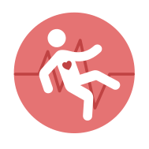
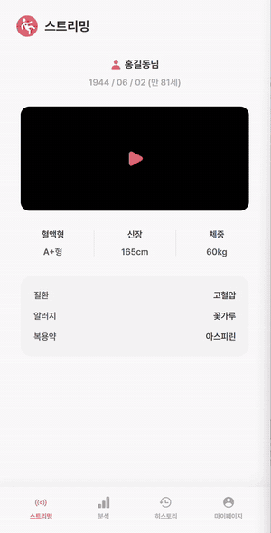
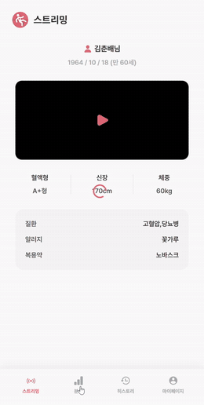
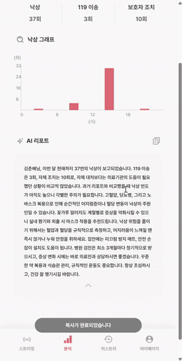
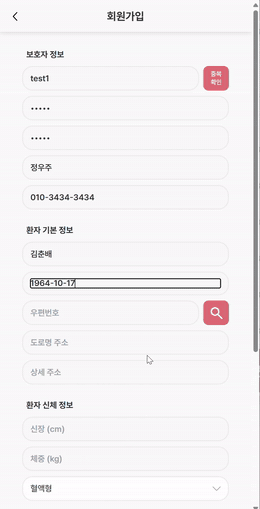
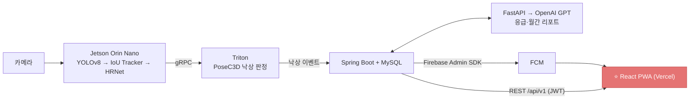

<div align="center">



# FAIN

**혼자 사는 노인의 낙상을 카메라와 AI로 감지해, 보호자가 알림 한 번으로 실시간 영상·AI 리포트를 보고 바로 대응하게 하는 보호자용 웹앱**

[📂 원본 레포](https://github.com/AIYA-CapstoneDesign/FAIN_FE) · [🏢 팀 Organization](https://github.com/AIYA-CapstoneDesign)




<sub>낙상 감지 알림 → 낙상 상세(실시간 영상 · 환자 정보 · AI 리포트 · 119 연결)</sub>

</div>

## 📌 About
> 전남대학교 소프트웨어공학과 소프트웨어공학종합프로젝트(캡스톤디자인) · 2025

- **문제**: 기저질환이 있는 독거노인은 낙상 후 도움을 바로 받지 못하고, 보호자는 상황을 알기 어렵다.
- **해결**: 카메라 영상에서 AI(YOLOv8 → HRNet → PoseC3D)가 낙상을 판정하면 보호자에게 **FCM 푸시 알림**을 보내고, 웹앱에서 실시간 영상·GPT 응급 리포트·월간 낙상 통계를 확인한다. 앱 설치 없이 쓰도록 **PWA**로 제공한다.
- **성과**: 과목 성적 **A+** · 요구사항 21개 항목 전부 구현 · 2025 한국스마트미디어학회 & 한국전자거래학회 춘계학술대회 논문(공저) · 학사 졸업논문(단독)

## 🙋‍♀️ My Role
**디자이너 없는 6인 팀에서 UI/UX 디자인과 프론트엔드를 혼자 맡았습니다.** (FE 레포 커밋 130건 · PR 34건)

- **UI/UX 디자인** — Figma로 와이어프레임·화면 설계, 컬러 8종·타이포 11종을 디자인 토큰으로 정해 Tailwind 설정으로 옮김
- **화면 11개 · API 15개 연동** — React 19 + TypeScript, 공통 컴포넌트 15종과 `useFormState` 등 커스텀 훅으로 구현
- **FCM 푸시 알림** — 로그인 후 토큰 발급·등록, 포그라운드 Emergency 모달 → `/emergency/:reportId` 이동, 백그라운드 서비스 워커 알림
- **인증·상태 관리** — Axios 인터셉터(JWT 첨부·401 처리), `PublicRoute`/`PrivateRoute`, Redux Toolkit(인증) + TanStack Query(서버 데이터·전역 로딩·에러)
- **월간 분석 시각화** — Recharts 6시간 구간 막대그래프, 월 이동, 데이터 없는 달 빈 상태
- 주 역할 외 — PWA(vite-plugin-pwa) 적용, Vercel 배포·캐시 설정, Issue·PR·커밋 템플릿 작성

## ✨ Features
| 월간 분석 | 히스토리 | 회원가입 |
| :---: | :---: | :---: |
|  |  |  |
| 월간 요약 · 시간대별 낙상 그래프 · AI 월간 리포트 | 월별 낙상 기록 → 상세 AI 리포트 복사 | 보호자·환자 정보 4묶음 입력, 주소 검색 |

> 낙상 판정 AI와 GPT 리포트 생성·알림 발송 서버는 팀원 구현이며, FE는 그 결과를 받아 보여주는 부분을 담당했습니다.

## 🛠 Tech Stack
| 분류 | 기술 |
| :--- | :--- |
| **Frontend** (담당) |          |
| **Notification · PWA** (담당) |   |
| **Design · Deploy** (담당) |   |
| **Backend** (팀) |       |
| **AI** (팀) |      |
| **Collaboration** |    |

## 🏗 Architecture

<sub>⭐ 본인 담당 · 나머지는 팀원 구현 (AI 3명 · BE 2명)</sub>

| FE 상태 구분 | 담당 | 내용 |
| :--- | :--- | :--- |
| 인증 · 사용자 정보 | Redux Toolkit + redux-persist | 토큰, 보호자·환자 정보 (새로고침 후 유지) |
| 서버 데이터 | TanStack Query | 낙상 상세 · 히스토리 · 월간 요약/그래프/AI 리포트, 정보 수정 mutation |
| 요청 상태 | TanStack Query 전역 | `useIsFetching`·`useIsMutating` 스피너, `QueryCache.onError` → `/error` |
| 인증 만료 | Axios 인터셉터 | 401 → 토큰 삭제 후 `/login` |

## 🔥 Troubleshooting
<details>
<summary><b>낙상 알림을 눌러도 상세로 못 가던 문제 — FCM 토큰 등록을 로그인 이후로 옮기고 알림 형식을 BE와 맞춤</b></summary>

- **문제**: 낙상 알림 → 해당 낙상 상세 화면 이동이 서비스의 핵심 흐름인데, 연동 단계에서 서버가 알림 받을 보호자를 모르고, 알림을 눌러도 이동할 리포트를 찾지 못함
- **원인**
  - 알림 권한 요청·토큰 발급이 **모듈 로드 시점(로그인 전)** 에 실행 → JWT 없이 등록돼 서버가 토큰 주인을 알 수 없음
  - FE는 `payload.data.data`를 JSON 파싱했지만, 실제 BE 메시지는 `data.reportId`만 담아 보냄 → 리포트 ID 추출 실패
- **해결**
  - 처음엔 `userId`를 함께 보내는 방식으로 구현했지만, 다른 사용자 ID로 위조할 수 있어 **로그인 성공 후 등록 + 서버가 JWT로 사용자 식별** 방식으로 BE와 함께 변경 (FE는 토큰만 전송)
  - `App.tsx`에서 `onMessage`를 한 번만 등록 → `payload.data.reportId`가 있을 때 Emergency 모달 → `/emergency/{reportId}` 이동
- **결과**: 알림 권한 허용 → 낙상 감지 → 모달 → 낙상 상세(실시간 영상·환자 정보·AI 리포트·119)까지 이어지는 흐름 완성, 알림 관련 요구사항 3건 완료
</details>

<details>
<summary><b>로딩·에러 상태가 Redux와 Query에 나뉘던 문제 — 요청 상태를 TanStack Query로 모아 전역 1곳에서 처리</b></summary>

- **문제**: 로그인·정보 수정은 Redux `createAsyncThunk` + 별도 `statusSlice`로, 리포트·분석은 TanStack Query로 처리 → API가 늘 때마다 Redux에 `pending/fulfilled/rejected` 케이스 추가, 스피너 기준도 불분명
- **원인**: "요청의 상태"인 로딩·에러를 Redux 전역 상태로 관리
- **해결**
  - 대안: ① Redux 유지 ② RTK Query로 통일(이미 만든 Query 화면 재작성 필요) ③ **역할 분리** → 변경 범위가 가장 작은 ③ 선택
  - `statusSlice` 삭제, 정보 수정은 `useMutation`으로 전환
  - 전역 로딩은 `useIsFetching`·`useIsMutating`, 전역 에러는 `QueryCache`·`MutationCache`의 `onError`, 인증 만료는 Axios 인터셉터로 일원화
- **결과**: 화면마다 따로 쓰던 로딩·에러 처리를 전역 1곳으로 정리 (해당 커밋 116줄 삭제 / 30줄 추가)
</details>

<details>
<summary><b>새로 배포해도 예전 화면이 보이던 문제 — 서비스 워커 즉시 교체와 캐시 버전 관리로 해결</b></summary>

- **문제**: PWA 적용 후 Vercel에 새로 배포해도 기기에서 이전 화면이 계속 보임 (시연 직전 수정이 많던 시기)
- **원인**: 서비스 워커와 브라우저가 이전 HTML·스크립트 캐시를 계속 사용
- **해결**
  - 대안: ① 사용자에게 캐시 삭제 안내 ② 새 버전 알림 UI ③ **서비스 워커 즉시 교체 + 캐시 무효화** → 사용자 행동이 필요 없는 ③ 선택
  - 서비스 워커 `install` 시 `skipWaiting()`, `activate` 시 이전 캐시 삭제 후 `clients.claim()`, `CACHE_NAME`으로 버전 관리
  - PWA `registerType: 'autoUpdate'`, `vercel.json`에 `Cache-Control` 헤더와 SPA 리라이트 추가
- **결과**: 최종 배포부터 새 버전이 바로 반영된 상태로 시연
- **아쉬운 점**: 모든 경로에 `no-store`를 걸어 해시가 붙은 JS·CSS까지 캐시하지 않음 → HTML만 no-cache로 두는 것이 더 적절
</details>

## 🔧 프로젝트 종료 후 개선 (2026.11)
> 포트폴리오를 정리하며 코드를 다시 보다가 찾은 한계 3가지를 고쳐 원본 레포에 PR로 올렸습니다.

| 개선 | 결과 | PR |
| :--- | :--- | :---: |
| **백그라운드 알림 클릭 처리** — 서비스 워커 `notificationclick` 추가, FCM SDK 자동 표시로 생기던 중복 알림 제거 | 서비스 워커 단위 테스트 **0/7 → 7/7** | [#69](https://github.com/AIYA-CapstoneDesign/FAIN_FE/pull/69) |
| **GPT 리포트 쿼리 캐싱** — 조회마다 GPT로 리포트를 다시 만드는 API 구조를 확인하고, 데이터별 `staleTime`과 변경 시점 무효화 설계 | 보호자 이동 흐름 기준 GPT 호출 **6회 → 3회** | [#70](https://github.com/AIYA-CapstoneDesign/FAIN_FE/pull/70) |
| **보호자·환자 정보를 TanStack Query로 전환** — Redux·localStorage에 있던 서버 데이터를 Query 캐시로 이동 | localStorage에 남던 개인·의료정보 **14개 필드 → 0개** | [#71](https://github.com/AIYA-CapstoneDesign/FAIN_FE/pull/71) |

<sub>※ 서버가 종료되어 실서버가 아닌 테스트·시뮬레이션 기준으로 측정했습니다.</sub>

<details>
<summary><b>📂 Folder Structure · 🚀 Getting Started</b></summary>

```
src
├─ api/          Axios 인스턴스·인터셉터, 도메인별 API
├─ app/          Redux store(redux-persist) · auth · guardian · patient slice
├─ components/   common(공통 컴포넌트) · 도메인별 컴포넌트
├─ pages/        로그인 · 회원가입 · 스트리밍 · 낙상 상세 · 분석 · 히스토리 · 마이페이지 …
├─ modals/       Emergency · 조치 선택 · 회원가입 완료 · 수정 완료
├─ routes/       PublicRoute · PrivateRoute · NotFound · Error
├─ hooks/        useFormState · useRedux
└─ utils/        firebase(FCM) · 날짜 · 주소 · 클립보드
public/          firebase-messaging-sw.js · manifest.json · fonts(Pretendard)
```

```bash
npm install
npm run dev
```

`.env`에 `VITE_BASE_URL`, `VITE_ADDRESS_BASE_URL`·`VITE_ADDRESS_SERVICE_KEY`, Firebase 설정값(`VITE_API_KEY` 등)과 `VITE_WEB_PUSH_CERTIFICATE_KEY_PAIR`가 필요합니다.

> ⚠️ 현재 백엔드·스트리밍 서버가 종료되어 화면만 실행되고 데이터 연동은 동작하지 않습니다.
</details>
